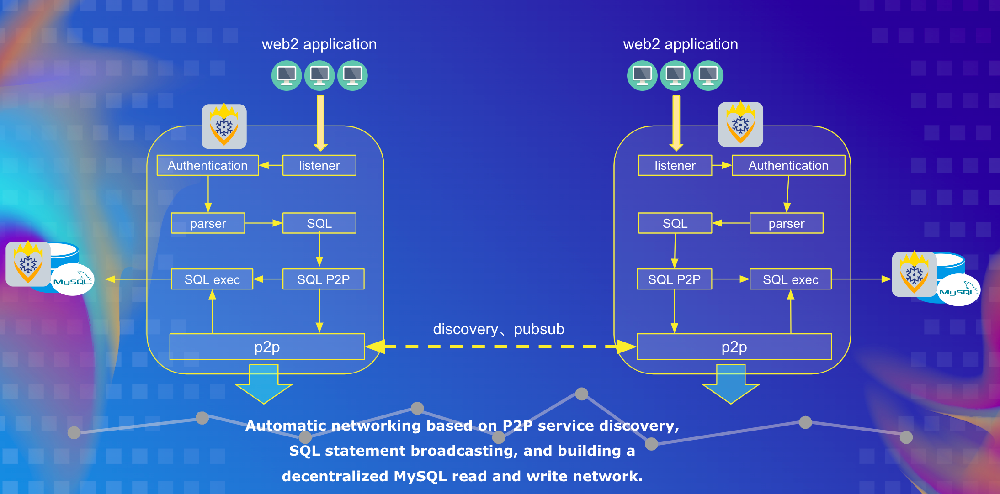

# IceFireDB-SQLProxy

IceFireDB-SQLProxy is a MySQL-protocol proxy that replicates writes to peer proxies over a
p2p network (libp2p gossipsub). A client connects with any MySQL client, the proxy executes
the statement on its local MySQL, and data-changing statements are published to peers, which
apply them to their own MySQL.

Version 1.0.0 is about being honest and reliable, not about new surface area: the replication
edge cases are fixed, read-only tenants work, connections are drained instead of dropped, and
the proxy reports what it did through `/healthz` and `/metrics`.



## What it guarantees — and what it does not

Read this before putting data behind it.

**Guarantees**

- A write that succeeded locally is published to the admin topic exactly once, in the order it
  was executed on that connection.
- A transaction (`BEGIN` … `COMMIT`) is published as one batch and applied atomically on each
  peer: peers see the whole transaction or none of it, never half.
- A rolled back transaction, or a statement that failed locally, is never published.
- Inbound messages are authenticated (HMAC-SHA256) when `p2p.authToken` is set, restricted by
  `p2p.allowedPeers` when configured, size-bounded, and limited to data-changing statements.
- A read-only tenant cannot write, at either end of the connection.

**Limits — by design, not by bug**

- Replication is **best-effort and eventually consistent**. There is no consensus, no leader,
  no conflict resolution, no ordering between different clients, and no catch-up: a peer that
  is offline when a write is published misses it permanently. Two nodes writing the same row
  concurrently will diverge.
- Nothing is retried. A message that the publish queue dropped, that failed to apply on a peer,
  or that arrived while the peer was disconnected is logged and counted
  (`sqlproxy_replication_publish_dropped_total`, `sqlproxy_replication_apply_failed_total`) and
  is your problem to reconcile — the proxies will not do it.
- Peers apply statements as SQL text, so a statement whose meaning depends on session state
  (`SET` variables, `NO_BACKSLASH_ESCAPES`, temporary tables) may behave differently on a peer.
- Prepared statements are replicated with their arguments inlined as literals. `NULL`, strings,
  numbers, binary values and times are handled; unusual types are refused rather than guessed.
- DDL replicates like DML, but MySQL commits implicitly before DDL, so a DDL statement inside a
  transaction splits it on the peer too.
- Multi-statement queries (`INSERT …; INSERT …`) replicate as one message and are applied in
  order, but transaction control statements inside such a batch are not tracked.
- Nodes of different major versions do not replicate to each other: a 1.0.0 node rejects the
  bare-SQL messages of pre-1.0.0 nodes when `p2p.authToken` is set.

See [docs/replication.md](docs/replication.md) for the message flow, the failure modes and how
to detect divergence.

## Quick start

```shell
# MySQL 8 on the machine, database `app` reachable as a user with write access
cd IceFireDB-SQLProxy
make build
./bin/IceFireDB-SQLProxy -c config/config.yaml
```

```shell
mysql -h 127.0.0.1 -P 33306 -u host1 -p     # password: host1 (from config.yaml)
```

Run a second node on another host with the same `p2p` topics and the same `authToken`; writes
through either node reach the other. For a private network, list the peers explicitly:

```yaml
p2p:
  bootstrapPeers:
    - "/ip4/10.0.0.5/tcp/4001/p2p/12D3KooW..." # node A's address from its /healthz
```

## Docker

The proxy is part of the repository's root Go module, so the build context is the repository
root:

```shell
docker build -f IceFireDB-SQLProxy/Dockerfile -t icefiredb/sqlproxy:1.0.0 .
docker run --rm -p 33306:33306 -v $PWD/config.yaml:/app/config/config.yaml \
  icefiredb/sqlproxy:1.0.0 -c /app/config/config.yaml
```

## Configuration

All fields are optional unless noted. Configuration is read once at startup; a missing or
malformed file is reported and the process exits.

| Field | Default | Meaning |
| --- | --- | --- |
| `server.addr` | `127.0.0.1:11001` | Address the proxy listens on for MySQL clients |
| `server.idleTimeout` | `0` (never) | Seconds a client may stay silent before it is disconnected |
| `server.writeTimeout` | `0` (unlimited) | Seconds allowed to write one response |
| `debug.enable` | `false` | Serve `/healthz` and `/metrics` |
| `debug.port` | `17878` | Port for those endpoints, bound to `127.0.0.1` only |
| `mysql.admin.*` | — | Upstream MySQL used by `admin` tenants: `addr`, `user`, `password`, `dbname`, `minAlive`, `maxAlive`, `maxIdle` |
| `mysql.readonly.*` | — | Upstream MySQL used by `readonly` tenants, same fields |
| `userlist[].user` / `.password` | — | Tenants the proxy accepts |
| `userlist[].role` | `admin` | `admin` may write, `readonly` is refused every write |
| `p2p.enable` | `false` | Enable replication |
| `p2p.serviceDiscoveryId` | — | Service name used for DHT discovery |
| `p2p.adminTopic` | — | Topic that carries replicated writes |
| `p2p.readonlyTopic` | — | Reserved for a read-only replication channel |
| `p2p.serviceDiscoverMode` | `advertise` | `advertise` (service discovery) or `announce` (DHT providers) |
| `p2p.nodeHostIp` / `nodeHostPort` | `0.0.0.0` / `0` | Address this node listens on; `0` picks a random port |
| `p2p.authToken` | empty | Shared HMAC-SHA256 secret. **Set it in any network you do not fully control** |
| `p2p.allowedPeers` | empty | libp2p peer IDs allowed to publish to this node |
| `p2p.bootstrapPeers` | empty | Multiaddrs dialled at startup; disables public DHT discovery |

`mysql.readonly.addr` is required as soon as a tenant has `role: readonly` — the proxy refuses
to start rather than silently serving a read-only tenant from the admin pool.

## Security

- Without `p2p.authToken`, any peer that joins the topic can publish writes that this node will
  execute against its MySQL. The proxy logs a warning at startup; it does not fail closed, so
  existing deployments keep working. Set the token.
- `p2p.allowedPeers` narrows the sender set to known peer IDs. Both checks are cheap; use both.
- `/healthz` and `/metrics` listen on loopback only. They expose schema-independent state (pool
  counts, replication counters), not query text.
- Passwords in the configuration file are plain text, as they are in the file for every other
  MySQL-facing tool in this repository. Protect the file's permissions.

## Operations

| Endpoint | Use |
| --- | --- |
| `GET /healthz` | `200` when every configured upstream pool answers a ping, `503` with `status: degraded` otherwise. Also reports p2p peers, this node's peer ID and its dialable multiaddrs. |
| `GET /metrics` | Prometheus text format: replication published/applied/dropped/failed/rejected counters, upstream pool connection gauges, p2p peer gauge, build info. |
| `SIGTERM` / `SIGINT` | Stop accepting, drain in-flight client connections (5s), close upstream pools, exit 0. A second signal exits immediately. |
| `SIGHUP` | Ignored: the configuration is read at startup only. |

`sqlproxy_replication_published_total` on node A minus `sqlproxy_replication_applied_total` on
node B is roughly the number of writes B never got. That gap is the number to alert on.

## Development

```shell
make build   # bin/IceFireDB-SQLProxy
make vet     # go vet ./...
make test    # unit tests
make e2e     # end-to-end: Docker + MySQL 8 + two proxy nodes (needs docker)
make race    # build with the race detector
```

## Disclaimers

By using this software, you agree that the author, maintainer, and contributors are not
responsible for any risks, costs, or problems you may encounter. If you find a software defect
or bug, please submit a patch to help improve it!
